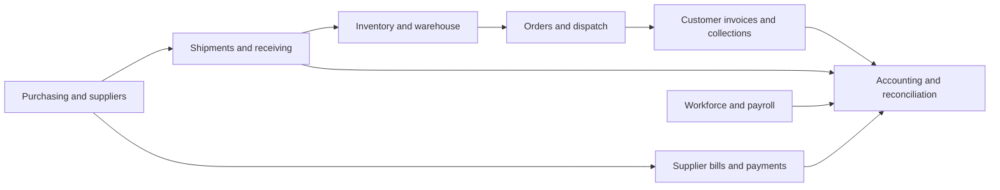

Aconcurrency scenario, device, external integration or regulatory outcome works in production.

## Overall feature description and necessity

| Feature family | What it does | Decision |
| --- | --- | --- |
| Dashboard and work profiles | Current business summaries, exceptions, customizable widgets/navigation and role presets | Essential. Keep one role-appropriate start page; reduce equally prominent widgets. |
| Products and catalogue | Products, categories, SKUs/barcodes, units, supplier links, prices/costs and stock thresholds | Essential. One Product workspace; technical configuration secondary. |
| Inventory position | Physical, reserved, allocated, available, incoming, held and damaged stock; warehouse breakdown | Essential. Reuse the authoritative position everywhere. |
| Warehouses and locations | Warehouse/bin stock, location lookup, transfers and receipt/putaway | Warehouse stock is essential. Bins and advanced WMS are configurable. |
| Warehouse execution | Keyboard/scanner flows for receiving, picking, packing, dispatch and counts | Necessary for warehouse teams. Simple warehouse-level workflows remain available. |
| Integrity, counts and traceability | Source-linked movements, count approval/adjustment, lots/serials/expiry, inspection and return states | Integrity and audit are essential. Lot/serial/expiry sophistication depends on the goods. |
| Orders and sales | Manual/channel/API/portal intake, customer/product matching, price/credit review, reservation and fulfillment | Essential. Present one order → fulfillment → recorded sale/invoice journey. |
| Customers and receivables | Customer balances, debt/payment history, advances, partial allocation, statements and aging | Essential. Make collection and correction actions reachable from Customer 360. |
| Procurement | Purchase requests, approvals, RFQs, supplier quotes, comparisons, awards and PO conversion | POs/approval are core. Full competitive sourcing is optional for routine repeat buying. |
| Suppliers and payables | Supplier records, bills, receipt/PO matching, payments, advances and allocation | Essential for the importing business. One supplier workbench should explain the entire obligation. |
| Shipments and incoming supply | PO cargo, shipment status, ETA, receipt progress and stock impact | Important for imports. Maps/AIS/provider details are optional and must reflect qualified evidence. |
| Landed cost | Freight/customs/other import costs, allocation, inventory valuation and accounting linkage | Important for reliable import margins. Keep with receipts and supplier costs. |
| Accounting | Chart of accounts, journals, posting/reversal, periods, reconciliation, trial balance and statements | Essential for accountant operation. Preserve immutable postings and control-account safeguards. |
| Finance overview and working capital | Operational cash/receivable/payable summaries and business interpretation | Useful, but currently overlaps the Accounting workspace and uses different bases in places. Consolidate presentation. |
| Cash, bank and expenses | Financial accounts, transfers, expense capture/payment, CSV statement staging and explicit matching | Essential. Cash/bank and expense workflows should live within the primary Finance workspace. |
| Tax/VAT and fiscalization | Configured tax classifications/snapshots, VAT preparation/reconciliation and controlled SEF TEST processing | Necessary where applicable. Current TEST/readiness boundaries are not production fiscal certification. |
| Employees and workforce | Employee profiles, dated terms, approved time/leave/overtime records and self-service | Business-specific. Keep separate from general user login management. |
| Payroll | Calculation, review, approval, posting, salary/liability payments, obligations and payslips | Necessary if payroll is run in AIMS. Validate actual company policy; do not expose sensitive administration to every manager. |
| Documents and exports | Shared source-linked documents, versions, permission checks, CSV/print/PDF output | Essential shared infrastructure. Continue using Document Center rather than separate attachment stores. |
| Action Center | Assigned/team tasks, ownership, due dates, approvals, exceptions and source actions | Essential daily coordination. A source problem should have one understandable identity and next action. |
| Notifications | Delivery of relevant unread/read notices with source navigation | Necessary channel. Work ownership and completion belong in Action Center. |
| Automation | Business events, versioned rules/templates, preview, tasks/drafts, controlled execution, retries and pause controls | Valuable, but begin with a small set of useful rules. Preserve one engine and human approval for commitments. |
| Ask AIMS | EN/SQ/contextual questions, authorized typed tools, explanations/evidence and reviewed action preparation | Useful first-class access point. Improve answers and missing-data explanations before adding another AI layer. |
| Analytics and domain intelligence | Historical/qualified inventory, customer, financial and shipment analysis, risk and forecast summaries | Useful when the evidence supports it. Put advice in the relevant workspaces instead of presenting many separate products. |
| Replenishment and decision review | Stock-risk evidence, alternatives, supplier/timing recommendations and draft-request lineage | High-value for distribution. Make “Replenishment” the understandable entry point. |
| Optimization, simulation and learning | Queued supply scenarios, assumptions, comparisons, outcome observation and reviewed policy candidates | Advanced options. Hide by default until data/history and company complexity justify them. |
| Search | Permission-filtered identifiers, indexed metadata, document/source search and local concept/typo matching | Essential. The current local hashed-concept provider is not a pretrained semantic language model. |
| API, MCP and webhooks | Scoped machine identities, read tools, bounded event delivery and integration diagnostics | Optional administrator capability until a real connection is needed. Finish compatibility contracts first. |
| Identity, roles and security | Login/refresh, passkeys, sessions, step-up checks, effective permissions and company policies | Essential. Recovery and role changes need practical drills, not just feature presence. |
| System Health and Integrity | Technical readiness/heartbeats versus business stock/subledger/GL controls | Both purposes are necessary. Use one clear overview with operational and technical drill-downs. |
| Company opening and imports | Staging/mapping/validation, approved imports, opening reconciliation and cutover | Essential before balances can be trusted. A readiness gate rather than an optional tutorial. |
| Support and pilot tools | Issue reports, privacy-bounded diagnostics, pilot observations and rollout evidence | Support is essential. Pilot/trial recording belongs under Help or authorized rollout administration. |
| Licensing and deployment | Package capabilities, signed installation/company licensing, grace, verified updates and backup/key checks | Necessary for commercial distribution, hidden from ordinary staff. Existing deployment/dependency gates still apply. |
| Desktop/local operation | Bundled runtime/backend, local operation and controlled update/recovery | Optional deployment channel. Preserve it without inventing multi-master offline synchronization. |
| Public-site CMS | Editing marketing headlines, features and about copy | Unnecessary inside tenant ERP settings. Retain only in appropriate platform/site administration. |

## Do the features work together?

The source largely connects the major workflows in the correct direction:

1. **Buying:** qualified planning → draft request → human approval → optional sourcing → PO → shipment → receipt → stock/valuation → supplier bill match → advance/payment allocation → accounting.
2. **Selling:** order intake → customer/credit review → reservation → picking/packing → dispatch → sale/invoice/AR → collection → cash/bank → accounting.
3. **Payroll:** dated employee terms and approved records → calculation/review → approval → accounting liabilities → financial-account payment → reconciliation.
4. **Month close:** source documents → operational/subledger/GL and bank reconciliation → readiness checks → controlled period close. Corrections retain reversal lineage.
5. **Coordination:** business events → the existing automation engine → source-linked Action Center work → authorized human review/draft → the original domain service → outcome/recovery.

`OrderHubService` explicitly treats intake as staging rather than another money/stock ledger. Procurement converts awards through `PurchaseOrderService`. `StockMovementService` and `OutboundService` retain quantity authority. `AccountingService` locks posting, checks balance and dates, and owns reversals. Payroll delegates money and journals to the established financial/accounting services. Bank imports stage rows before explicit matching.

These are good boundaries. Remaining integration work is chiefly about completeness, source attribution and user meaning. A common service call does not itself prove every edge case has passed a current real-company journey.

## Concrete problems found in current source

### 1. Finance cards can describe different financial realities

`FinanceCenter` consumes `FinanceService`, including operational invoice/VAT and cash-source perspectives. `AccountingControlCenter` consumes posted General Ledger/control values. `MoneyAccounts` exposes related account operations through another destination.

`FinanceService::cashflow()` explicitly returns `reconciled: false` and warns that Daily Sales receipts and PO payments are disclosed separately but excluded from its canonical cash totals because reliable attribution is incomplete. It also distinguishes issued-invoice sales from standalone Daily Sales. Identically styled “Sales”, “Cash” or “Expenses” cards can consequently differ by basis.

**Decision:** one primary Finance workspace, explicit “Posted books”, “Operational source” and “Forecast” bases, with source/date drill-down. Retain the underlying services until responsibilities are reconciled; do not hide differences by editing balances.

### 2. International finance is a partial foundation

`OperationalAccountingService::postInvoice()` blocks non-base-currency customer invoice accounting. `FinancialAccountService::transfer()` requires same-currency accounts and then additionally requires company base currency. Historical foreign supplier payment rates are supported in `PurchaseOrderService`.

**Decision:** describe FX accurately as partial import support. Complete carrying-value transfers, settlements/revaluation only through an accountant-reviewed design and focused lifecycle/concurrency evidence. Do not market this as full multicurrency treasury today.

### 3. Some administration is in the wrong place

`/cms` is labeled “System Settings”, but `Cms` edits public landing-page copy. `CmsService::listEditable()` filters `company_id IS NULL`, while the model's company scope also filters authenticated tenant-company records. That is a source-level scope conflict for a normal tenant administrator and a misleading navigation label.

`Reports` mixes inventory reporting with portable backup inspection/restore and data transfer.

**Decision:** move public-site CMS to platform administration; put recovery under System Health; leave business exports in Reports. Preserve existing permission and service boundaries.

### 4. MCP negotiation and discovery disagree

`McpServer` initialization accepts two protocol-version values, while discovery/error metadata and later request handling advertise/accept an additional one. This is an internal contract inconsistency; this review makes no claim about the official status of a protocol revision.

**Decision:** align one supported-version definition and verify initialization, discovery, legacy handling and denied requests before customer MCP activation.

### 5. Advice, pure reads and analysis preparation need clearer labels

The external MCP allowlist is a restricted read projection. The broader assistant tool catalogue also contains creation of persisted analysis/simulation jobs. Neither should imply permission to post money or stock commitments.

**Decision:** distinguish “Read company data”, “Prepare analysis” and “Prepare business draft”; keep permissions, evidence gates, current-state revalidation and explicit confirmation. No new AI version is needed.

### 6. Rule browsing inherits an existing server-list limit

The automation endpoint paginates 50 rules; Studio currently fetches its initial page. The six-card display pages the loaded rule records and the full template catalogue. Very large rule collections still need server-backed paging/filtering rather than suggesting that a local search covers unloaded records. Direct source-linked rule URLs continue to use the existing detail endpoint.

**Decision:** complete server-backed rule search/paging before a larger automation rollout. Keep requests bounded and company-scoped.

### 7. Operational recovery must outrank feature expansion

The recent local MariaDB startup failure required journal/system-table recovery. A preserved recovery record identifies two damaged database grant rows that were not recovered. Company tables being accessible is not proof of complete restore/deployment readiness.

**Decision:** complete a recovery audit, verify database grants, supervise startup/shutdown, use dedicated deployment credentials, and demonstrate backup restore into a separate installation before wider deployment. Do not substitute an attractive health banner for operational proof.

## What I would change next, in order

| Priority | Selected update | Completion evidence |
| --- | --- | --- |
| 1 | Reliability and opening-data trust | Controlled restart; clean database/system checks; reviewed grants; verified encrypted backup/restore with the original key; opening/subledger reconciliation. |
| 2 | One daily workspace per role | Refined existing owner/sales/warehouse/purchasing/finance/HR profiles; advanced tools secondary; representative users can complete routine journeys without guessing between pages. |
| 3 | Finance and sales-source consolidation | Explicit source/date basis; complete order → dispatch/sale → invoice/credit note → payment lineage; explained operational/GL differences; accountant month-close journey. |
| 4 | Small operational automation pilot | One replenishment and one collections case: ownership, duplicate delivery, stale evidence, human approval, resolution and recurrence. Measure usefulness rather than rule count. |
| 5 | Administration and extension contracts | Correct CMS placement/scope; recovery placement; one MCP version contract; permission/capability/navigation/tool compatibility checks. |
| 6 | Qualified company-specific finance/payroll/fiscal journeys | Real import/advance/FX cases, actual payroll policy and registered TEST fiscal scenarios, with review by the responsible specialists. |
| 7 | Maintainability and bounded performance | Incremental extraction of large pages/services, clear summary/detail APIs, query budgets and source-linked diagnostics; preserve domain authorities. |

Defer new manufacturing, gastronomy, retail, another AI layer, enterprise SSO and extra integrations until a demonstrated company need justifies their cost and controls. Keep 3D/AIS, optimizer/simulation/learning, full RFQ tendering and advanced tracking as configurable capabilities; they do not belong in every employee's default navigation.

## Changes made for the six browser comments

- Centered the passkey sign-in action and made it secondary to password sign-in.
- Replaced registration example-person/account placeholders with localized Name and Email address prompts.
- Restyled connection notices and the labelled retry button; optional Redis degradation is separate from endpoint/cache failure.
- Moved feedback and pilot-trial access into Help in the workspace toolbar; removed the per-page footer.
- Replaced the narrow automation list with a full-width library: six cards per page, search, canonical business-area filters, rule/template tabs and preserved browsing state. Selecting a template still prepares a disabled draft through the existing flow. Health and company pause controls remain available under a clearly labelled disclosure.

These changes preserve business authorities, approvals and company boundaries. The broader roadmap above is the selected next work, not a claim that all of it has already been implemented. No major new phase was automatically started.

## Evidence and verification scope

Current code was reviewed across application routes, work profiles, domain services, registries and integration boundaries. High-value evidence:

- [Order intake](../../backend/app/Services/OrderHubService.php), [stock](../../backend/app/Services/StockMovementService.php), [fulfillment](../../backend/app/Services/OutboundService.php), [procurement](../../backend/app/Services/ProcurementService.php), [payroll](../../backend/app/Services/Workforce/PayrollService.php).
- [Posted books](../../backend/app/Services/AccountingService.php), [operational finance](../../backend/app/Services/FinanceService.php), [cash transfers](../../backend/app/Services/FinancialAccountService.php), [invoice accounting](../../backend/app/Services/OperationalAccountingService.php), [TEST fiscalization](../../backend/app/Integrations/Sef/FiscalizationService.php).
- [Automation](../../backend/app/Services/AutomationService.php), [action registry](../../backend/app/Services/AutomationRegistry.php), [MCP](../../backend/app/Services/Platform/McpServer.php), [CMS service](../../backend/app/Services/CmsService.php), [company scope](../../backend/app/Traits/BelongsToCompany.php).
- [Role workspaces](../../frontend/src/config/workProfiles.js), [navigation](../../frontend/src/config/navigation.js), [inventory reports/backup placement](../../frontend/src/pages/Reports.jsx), and the current DC3/DC4/DC8 operational limitations.

The focused validation for this change is recorded in [UI follow-up validation](UI-FOLLOWUP-VALIDATION.json). The feature catalogue is a source-grounded assessment, not a rerun of every historical certification suite or a declaration of regulatory/security/accounting compliance.
